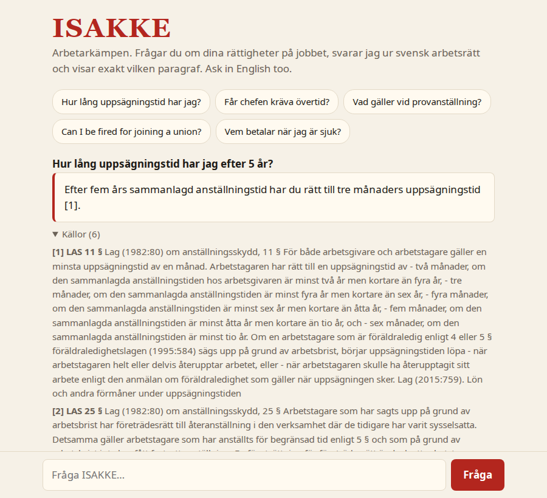
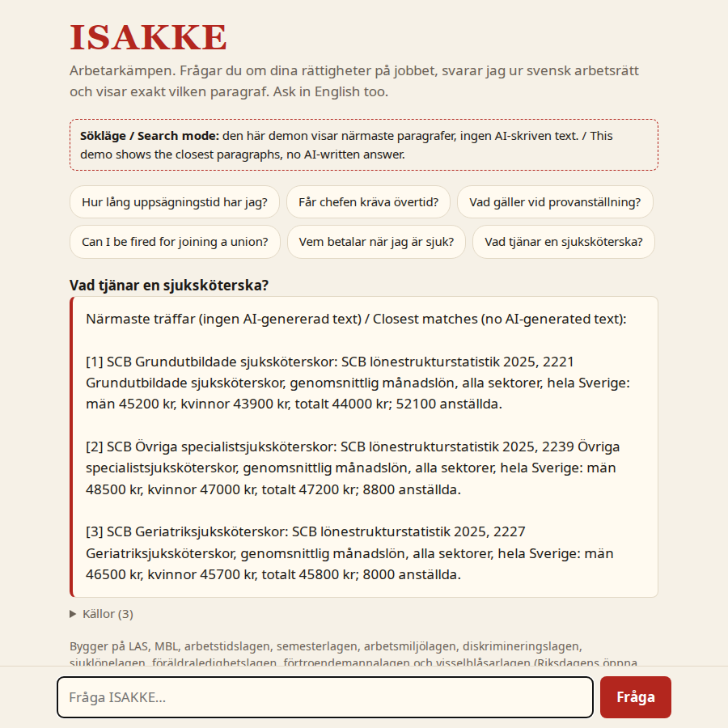

# ISAKKE

**The workers' champion.** Ask about your rights at work in Sweden, in Swedish or English. ISAKKE answers from the actual labour law and shows exactly which paragraph it used.

A small RAG (retrieval-augmented generation) app that runs fully local: no cloud API, no data leaves the machine.



[56 s screencast](docs/demo.mp4): a Swedish law question, an English one, and a pay question.

## How it works

1. **Fetch:** ten Swedish labour laws come from Riksdagen's open data API (public domain): LAS, MBL, the Working Hours Act, the Holiday Act, the Work Environment Act, the Discrimination Act, the Sick Pay Act, the Parental Leave Act, the Union Representatives Act and the Whistleblower Act.
2. **Index:** each law is split by paragraph (§), keeping chapter numbers ("AML 3 kap. 2 §"), and transitional rules are dropped. 610 paragraphs are embedded with `bge-m3` (multilingual, so English questions find Swedish law) and stored as a normalised numpy matrix.
3. **Ask:** the question is translated to Swedish (the laws are Swedish and English queries rank worse), embedded, the six closest paragraphs are found by cosine similarity, and a local model (`gemma4:e4b`) answers using only those, citing them as [1], [2]. The sources are shown under each answer. Ask what a profession earns and it fetches live average pay (and the gender gap) from SCB's open statistics instead.

**Pay questions:** the same call that translates the question also spots "what does a nurse earn?". The 431 SSYK occupations from SCB are embedded too; the closest ones are looked up live in SCB's open API (no key, CC0) and passed to the model as sources, biggest occupation first. Needs internet access to `api.scb.se`.

**Off-topic check (decision model):** a question that is clearly about work passes, one that clearly isn't ("Hur lagar jag pasta?") gets a short refusal, and only the borderline band is judged by a decision model, [Together's `tev1`](https://ollama.com/library/tev1) through Ollama's `/v1/systemone` endpoint, which returns a probability instead of text. It runs on the CPU (`decider.Modelfile`) so it doesn't push the chat model out of a small GPU. It is optional: without it, only the clearly off-topic are refused. Measured on 12 on-topic and 7 off-topic questions: the retrieval score alone separates them by a margin of 0.05, `tev1` by 0.80 vs 0.02. Using it to route questions to a single law did not help: retrieval already ranked the right paragraph in the top six for 16 of 16 test questions.

Plain Python and numpy, one file (`isakke.py`), a stdlib web server and one HTML page. At this size (610 vectors) a matrix product beats running a vector database.

## Run

```sh
ollama pull bge-m3 && ollama pull gemma4:e4b
ollama pull tev1 && ollama create isakke-decider -f decider.Modelfile   # optional: off-topic check, needs Ollama 0.35+
pip install numpy
python3 isakke.py fetch      # laws/ is already in the repo; this refreshes it
python3 isakke.py serve      # builds the index on first run, then http://localhost:8095
python3 isakke.py ask "Hur lång uppsägningstid har jag?"
```

Or with Docker, in one of two profiles:

| | Desktop (`compose.yml`) | Slim (`compose.slim.yml`) |
|---|---|---|
| Hardware | NVIDIA GPU with ~6 GB, 14+ GB RAM | any CPU, ~2 GB RAM, no GPU |
| Answers | `gemma4:e4b` writes a cited answer, `tev1` decision model on the CPU checks the borderline off-topic cases | no generated text: the closest paragraphs, cited |
| First start | pulls ~12 GB of models (about 15 min at 13 MB/s) | pulls ~1.2 GB |
| Speed | ~3 s per answer warm, ~100 s for the first one while the models load | 0.1–0.2 s warm, ~2.5 s after the model has unloaded |

```sh
docker compose up -d                       # desktop; needs the NVIDIA container toolkit (nvidia-ctk runtime configure --runtime=docker)
docker compose -f compose.slim.yml up -d   # slim
```

Then http://127.0.0.1:8095. The slim profile exists because small models can't do this job on a CPU: below ~3B they invent figures ("14 days notice"), and a correct 3B takes 30–100 s per answer on 4 threads. So it shows the law instead of paraphrasing it. A live slim demo runs on a 2 vCPU / 4 GB VPS (`deploy/`), capped at 2 GB RAM, using ~100 MB when idle.



Settings: `CHAT_gemma4:e4b`, `EMBED_gemma4:e4b`, `OLLAMA`, `PORT`, `INDEX`.

## Limits

ISAKKE knows the law, not your collective agreement (kollektivavtal), which often gives more. It is not legal advice; it points you to your union, safety representative or a lawyer when the law isn't enough.
