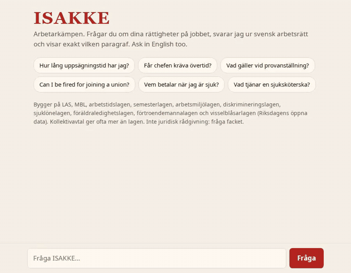
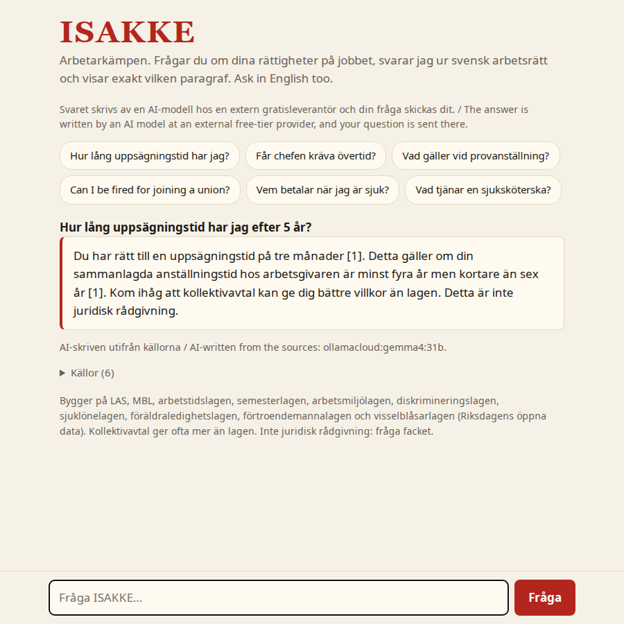

# ISAKKE

**The workers' champion.** Ask about your rights at work in Sweden, in Swedish or English. ISAKKE answers from the actual labour law, shows exactly which paragraph it used, and looks up what a profession earns from Statistics Sweden's open data.

A small RAG (retrieval-augmented generation) app, local first: the desktop setup runs entirely on your own machine, with no cloud API and no data leaving it. A slim profile runs on any CPU, and the public demo lets free-tier hosted models write the answers (see [Hosted models](#optional-hosted-free-tier-models)).



## Try it

```sh
ollama pull bge-m3 && ollama pull gemma4:e4b
pip install numpy
python3 isakke.py serve      # builds the index on the first run, then http://localhost:8095
python3 isakke.py ask "Hur lång uppsägningstid har jag?"
```

Or with Docker, see [Docker profiles](#docker-two-profiles). Needs [Ollama](https://ollama.com) and about 6 GB of VRAM for the desktop setup; the slim profile needs neither a GPU nor more than ~2 GB of RAM.

## How it works

1. **Fetch:** ten Swedish labour laws come from Riksdagen's open data API (public domain): LAS, MBL, the Working Hours Act, the Holiday Act, the Work Environment Act, the Discrimination Act, the Sick Pay Act, the Parental Leave Act, the Union Representatives Act and the Whistleblower Act.
2. **Index:** each law is split by paragraph (§), keeping chapter numbers ("AML 3 kap. 2 §"), and transitional rules are dropped. The 610 paragraphs are embedded with `bge-m3` (multilingual, so English questions find Swedish law) and stored as a normalised numpy matrix. At this size a matrix product beats running a vector database.
3. **Ask:** the question is translated to Swedish (the laws are Swedish and English queries rank worse), embedded, and the six closest paragraphs are found by cosine similarity. A local model (`gemma4:e4b`) answers using only those and cites them as [1], [2]. The sources are shown under each answer.
4. **Pay questions** ("vad tjänar en sjuksköterska?"): the 431 occupations of SCB's SSYK classification are embedded too. The closest ones are looked up live in SCB's open API (no key, CC0) and passed to the model as sources, biggest occupation first, with the gender gap. Needs internet access to `api.scb.se`.
5. **Off-topic check:** a clearly work-related question passes, a clearly unrelated one ("Hur lagar jag pasta?") gets a short refusal, and only the borderline band is judged by a decision model, [Together's `tev1`](https://ollama.com/library/tev1) through Ollama's `/v1/systemone` endpoint, which returns a probability instead of text. It runs on the CPU (`decider.Modelfile`) so it doesn't push the chat model off a small GPU, and it is optional.

```
question ─┬─ pay question ────────────────────► SCB open API, live ─────────────────────────────────┐
          └─ law question ─► bge-m3 embedding ─► cosine over 610 § vectors (numpy)                   │
                              └─ off-topic check: score, then the tev1 decision model if borderline  │
                                                                                                     ▼
                                  the six closest paragraphs, or the SCB figures, become the sources
                                                                                                     ▼
   desktop: gemma4:e4b via Ollama (GPU)  |  demo: hosted free-tier chain  |  slim: show the paragraphs
                                                                                                     ▼
                  answer + cited sources (+ a flag for numbers not in the sources) ─► web page, one JSON log line
```

| Part | What it is |
|---|---|
| App | one Python file (`isakke.py`), stdlib web server, numpy for the vector search, one HTML page |
| Models | [Ollama](https://ollama.com): `bge-m3` embeddings, `gemma4:e4b` answers (desktop), `tev1` decision model on the CPU (optional) |
| Data | Swedish laws from Riksdagen, pay statistics from SCB (both open, no keys) |
| Packaging | Docker Compose, two profiles (desktop, slim) |
| Demo hosting | a shared 2 vCPU VPS, Caddy for HTTPS, `deploy/deploy.sh`, a per-IP rate limit and capped containers |

The desktop profile translates the question with the chat model first. The slim profile has no chat model to spare, so it adds Swedish terms from a small glossary to English questions and recognises pay questions with a regex.

## Docker: two profiles

| | Desktop (`compose.yml`) | Slim (`compose.slim.yml`) |
|---|---|---|
| Hardware | NVIDIA GPU with ~6 GB, 14+ GB RAM | any CPU, ~2 GB RAM, no GPU |
| Answers | `gemma4:e4b` writes a cited answer; the `tev1` decision model on the CPU checks borderline off-topic cases | no generated text: the closest paragraphs, cited |
| First start | pulls ~12 GB of models (about 15 min at 13 MB/s) | pulls ~1.2 GB |
| Speed | ~3 s per answer warm, ~100 s for the first one while the models load | 0.1–0.2 s warm, ~2.5 s after the model has unloaded |

```sh
docker compose up -d                       # desktop; needs the NVIDIA container toolkit (nvidia-ctk runtime configure --runtime=docker)
docker compose -f compose.slim.yml up -d   # slim
```

Then open http://127.0.0.1:8095. The slim profile exists because small models can't do this job on a CPU (see below), so it shows the law instead of paraphrasing it. A live slim demo runs from `deploy/` on a 2 vCPU / 4 GB VPS with no GPU, capped at 2 GB RAM and using ~100 MB when idle.



### Optional: hosted free-tier models

The slim demo can let free-tier models write the answer while retrieval, the SCB lookup and the citations stay local. Set `LLM_CHAIN="provider:model,…"` plus the keys (see `.env.example`; providers: gemini, groq, openrouter (`:free` models only), ollamacloud, or any OpenAI-compatible `default` via `LLM_BASE_URL`). Models are tried in order, and one that runs out of quota is skipped until it resets. AI answers are capped per day (`LLM_DAILY_MAX`, `LLM_PER_IP_DAY`); beyond the caps, or when every model fails, the page shows the closest paragraphs instead. Numbers in an answer that are not in the cited paragraphs are flagged under it. The page tells visitors that their question is sent to an external provider and which model wrote each answer. Every page visit and question is logged as one JSON line (client, question, kind, paragraphs, model, time), and Docker keeps three 5 MB files, so the log never fills the disk.

### Settings

Environment variables: `CHAT_MODEL` (empty = no local chat model), `EMBED_MODEL`, `DECIDER_MODEL` (empty = off), `OLLAMA`, `HOST` (default 127.0.0.1), `PORT`, `INDEX`, `MIN_SCORE`, `RATE_LIMIT` (per IP per minute, 0 = off), and for hosted models `LLM_CHAIN`, `LLM_DAILY_MAX`, `LLM_PER_IP_DAY` plus the keys.

Tests: `python3 isakke.py test` (paragraph splitter, number check, rate limiter); `python3 bench.py MODEL…` runs three questions with known answers against a model.

## What I measured

Choices in this repo come from measurements on an RTX 3060 laptop (6 GB VRAM) and a 2 vCPU VPS, not from defaults.

- **Chat model:** seven models on three questions with known answers ([`bench-results.md`](bench-results.md)). `gemma4:e4b` won: correct, cites the paragraph, 3–4 s. Models over ~5.5 GB spill from the GPU to the CPU and get 5–10x slower; `gemma3:4b` said "2 months" notice where the law says 3.
- **English questions:** `bge-m3` finds Swedish law from English, but the notice-period question ranked the right paragraph 12th. Translating the question first (desktop) or adding Swedish terms from a glossary (slim) moves it to 1st–2nd; the glossary alone puts the right paragraph in the top three for 11 of 12 English test questions.
- **Small models on a CPU (4 threads):** models of 2B or less invent figures ("14 days notice", "16 vacation days") and can't follow the format. A 3B model was correct but took 30–100 s per answer. Hence the slim profile shows paragraphs instead of generating text.
- **Decision models:** routing a question to one law gave no gain, because retrieval already ranked the right paragraph in the top six for 16 of 16 test questions. A decision model as a citation checker failed (it scored a wrong "four months" above the right "three months"). As an off-topic gate it works: `tev1` scores work questions 0.80–0.91 and unrelated ones 0.00–0.02, where the retrieval score alone separates them by only 0.05, hence the cascade.
- **Thinking models:** `gemma4` over the OpenAI-compatible endpoint spends its whole token budget thinking unless the reasoning level is set. The code sets it per provider; a cut-off reply is treated as a failure and falls through to the next model.
- **Number check:** a deterministic check flags numbers in an answer that are not in the cited paragraphs. It also flags the correct "14 days" of sick pay (the law says the first day plus thirteen), so it is a prompt to check, not a block.

## Limits

ISAKKE knows the law, not your collective agreement (kollektivavtal), which often gives more. It is not legal advice; it points you to your union, safety representative or a lawyer when the law isn't enough. The slim demo's answers depend on free-tier models and their quotas.

## Licence

[PolyForm Noncommercial 1.0.0](LICENSE): free to read, run and modify for non-commercial use. The laws and statistics it uses are public data.
